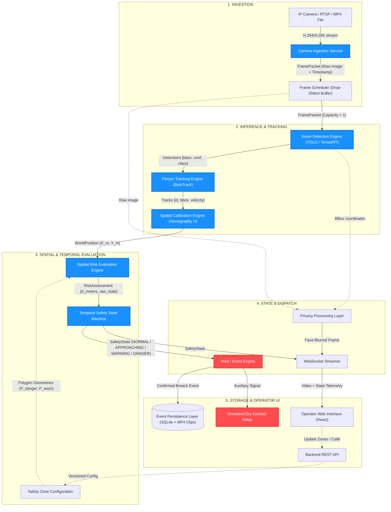
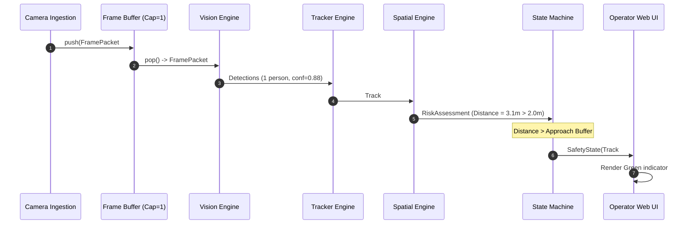
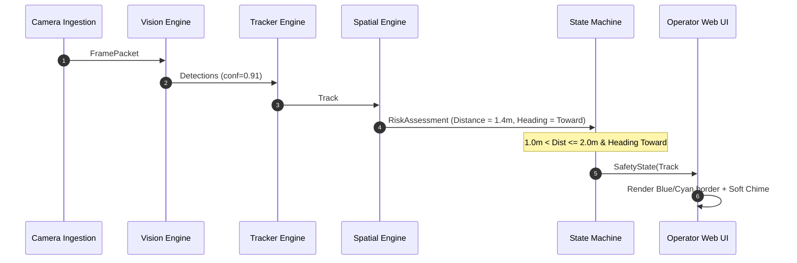
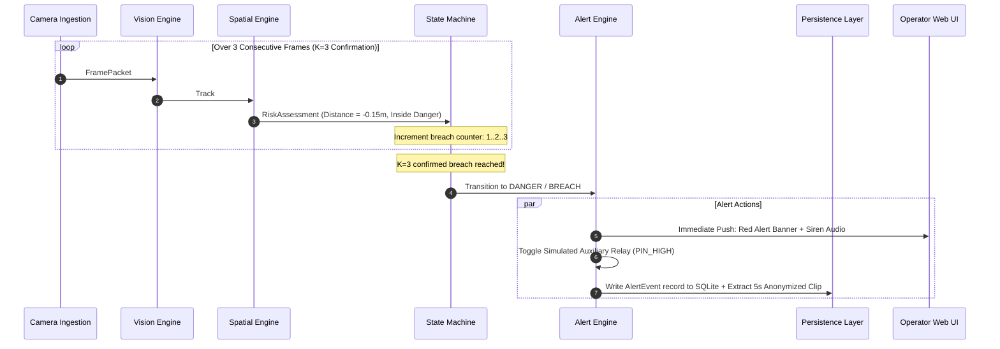

# WorkSafe AI — System Architecture Specification

**Document Version:** 1.0.0  
**Status:** Architecture Design Phase  
**Author:** Lead Software Architect, WorkSafe AI Team  
**Workspace:** `WorkSafe-AI`  
**Reference Documents:**
- [`PROJECT_DISCOVERY.md`](file:///c:/Users/Asus/OneDrive/Pictures/Documents/WorkSafe-AI/PROJECT_DISCOVERY.md)
- [`PROBLEM_VALIDATION.md`](file:///c:/Users/Asus/OneDrive/Pictures/Documents/WorkSafe-AI/PROBLEM_VALIDATION.md)
- [`REAL_WORLD_VALIDATION.md`](file:///c:/Users/Asus/OneDrive/Pictures/Documents/WorkSafe-AI/REAL_WORLD_VALIDATION.md)  
**Date:** September 2026  

---

## CRITICAL SAFETY & COMPLIANCE BOUNDARY DISCLAIMER

> [!CAUTION]
> **SUPERVISORY SYSTEM ONLY — NOT A SAFETY-CERTIFIED SYSTEM**  
> WorkSafe AI is architected strictly as an **advisory, secondary supervisory monitoring and cognitive alerting system**.  
> - It is **NOT** certified under IEC 61508, ISO 13849-1/2, or IEC 61496-1/4.  
> - It does **NOT** achieve any Safety Integrity Level (SIL) or Performance Level (PL e / PL d).  
> - It **CANNOT** and **MUST NEVER** replace statutory, certified primary safeguards, including mechanical safety cages, physical interlocking switches, optical safety light curtains, or hardwired Emergency Stop (E-Stop) circuits.  
> - Any hardware relay or dry-contact outputs described in this architecture are strictly **simulated / prototype integrations** for alerting beacons and supervisory indicators; they must **NEVER** be wired directly into a machine's primary emergency shut-down loop.

---

## 1. Architecture Overview

### 1.1 System Mission & Core Value
WorkSafe AI provides real-time, computer-vision-based supervisory monitoring of software-configured workplace danger and exclusion zones. The system monitors stationary or cyclic machinery perimeters, detects humans approaching or encroaching on defined spatial envelopes, projects their physical ground-contact coordinates onto a calibrated metric floor plane, filters transient optical noise through temporal state machines, and dispatches multi-tiered supervisory alerts while maintaining privacy-by-design.

### 1.2 Core Architectural Principles
1. **Strict Decoupling & Independent Testability:** Every engine (ingestion, inference, tracking, geometry, state machine, alerting) is an isolated module with deterministic interfaces, allowing end-to-end testing with synthetic data and recorded video feeds without hardware dependencies.
2. **Separation of Concerns in Safety Logic:**
   $$\text{Raw Observations} \longrightarrow \text{Spatial Interpretation} \longrightarrow \text{Temporal Filtering} \longrightarrow \text{Risk State} \longrightarrow \text{Alert Dispatch}$$
   A single low-confidence detection or single-frame flicker is mathematically prohibited from triggering a high-severity alert.
3. **Bounded Real-Time Execution:** Zero unbounded queues. All inter-thread and inter-process buffers use a drop-oldest policy to prevent latency lag.
4. **Fail-Safe Observability:** The system will never silently display stale or frozen frames as live video. Sensor failures trigger immediate system-level faults.
5. **Configurable & Versioned Safety Parameters:** All geometric distances, frame counts, and confidence thresholds are treated as **unvalidated prototype parameters** that must be calibrated empirically per installation.

---

## 2. Component Architecture

```
+-------------------------------------------------------------------------------------------------------+
|                                    WORKSAFE AI COMPONENT MAP                                          |
+-------------------------------------------------------------------------------------------------------+
|                                                                                                       |
|  [ INGESTION & VISION PIPELINE ]                                                                      |
|  +---------------------------+     +---------------------------+     +-----------------------------+  |
|  | 1. Camera Ingestion       | --> | 2. Frame Buffer /         | --> | 3. Vision Detection         |  |
|  |    Service (RTSP/V4L2)    |     |    Scheduler (Drop-old)   |     |    Engine (YOLO / TensorRT) |  |
|  +---------------------------+     +---------------------------+     +-----------------------------+  |
|                                                                                    |                  |
|                                                                                    v                  |
|  [ SPATIAL & TEMPORAL REASONING ]                                    +-----------------------------+  |
|  +---------------------------+     +---------------------------+     | 4. Person Tracking          |  |
|  | 6. Safety Zone            |     | 5. Spatial Calibration &   | <-- |    Engine (ByteTrack)       |  |
|  |    Config Engine          |     |    Homography Engine      |     +-----------------------------+  |
|  +---------------------------+     +---------------------------+                   |                  |
|                |                                 |                                 v                  |
|                +----------------+----------------+                   +-----------------------------+  |
|                                 |                                    | 7. Spatial Risk Evaluation  |  |
|                                 v                                    |    Engine (PIP + Metric Dist)| |
|                    +---------------------------+                     +-----------------------------+  |
|                    | 8. Temporal Safety        | <---------------------------------+                  |
|                    |    State Machine          |                                                      |
|                    +---------------------------+                                                      |
|                                 |                                                                     |
|                                 v                                                                     |
|  [ ALERTING, PERSISTENCE & PRIVACY ]                                                                  |
|  +---------------------------+     +---------------------------+     +-----------------------------+  |
|  | 9. Alert / Event          |     | 10. Privacy Processing    |     | 11. Event Persistence       |  |
|  |    Engine (PubSub/Relay)  |     |     Layer (Face Blur)     |     |     Layer (SQLite / Clips)  |  |
|  +---------------------------+     +---------------------------+     +-----------------------------+  |
|                                                                                                       |
|  [ SUPERVISION, OBSERVABILITY & INTERFACES ]                                                          |
|  +---------------------------+     +---------------------------+     +-----------------------------+  |
|  | 12. Camera/System         |     | 13. Backend API           |     | 14. Real-Time WebSocket     |  |
|  |     Health Monitor        |     |     (FastAPI REST)        |     |     Event Channel           |  |
|  +---------------------------+     +---------------------------+     +-----------------------------+  |
|                |                                 |                                 |                  |
|                +---------------------------------+---------------------------------+                  |
|                                                  |                                                    |
|                                                  v                                                    |
|                                    +---------------------------+                                      |
|                                    | 15. Operator Web UI       |                                      |
|                                    |     (React / Vite SPA)    |                                      |
|                                    +---------------------------+                                      |
|                                                                                                       |
|  [ CROSS-CUTTING FOUNDATIONS ]                                                                        |
|  +---------------------------+     +---------------------------+     +-----------------------------+  |
|  | 16. Configuration         |     | 17. Logging &             |     | 18. Testing                 |  |
|  |     Management (Versioned)|     |     Observability (Metrics|     |     Infrastructure          |  |
|  +---------------------------+     +---------------------------+     +-----------------------------+  |
+-------------------------------------------------------------------------------------------------------+
```

---

### Component 1: Camera Ingestion Service
- **Responsibility:** Ingests live video from RTSP streams, USB/webcams, or pre-recorded test MP4 files; decodes frames via hardware acceleration where available; timestamps frames with high-resolution monotonic clocks.
- **Inputs:** RTSP URL / V4L2 device index / File path; connection parameters.
- **Outputs:** Raw `FramePacket` stream.
- **Interfaces:** `ICameraIngestionService` (`start()`, `stop()`, `get_latest_frame()`, `get_health()`).
- **Dependencies:** OpenCV (`cv2.VideoCapture`), FFmpeg, GStreamer backend.
- **Failure Modes:** RTSP connection loss, camera power loss, corrupted video stream, network packet jitter.
- **Recovery Behavior:** Automatic reconnect with exponential backoff ($1\text{ s}$ to $30\text{ s}$); immediately emits `CameraHealth.DISCONNECTED` event.
- **Test Strategy:** Unit test with mock video files; failure-injection test dropping RTSP server socket mid-stream.

### Component 2: Frame Buffer / Frame Scheduler
- **Responsibility:** Manages the inter-thread bounded queue between video ingestion and inference. Enforces zero latency lag by dropping stale frames when inference is backpressured.
- **Inputs:** `FramePacket` instances from Ingestion Service.
- **Outputs:** Scheduled `FramePacket` dispatched to Vision Engine.
- **Interfaces:** `IFrameBuffer` (`push(frame)`, `pop()`, `get_dropped_count()`, `clear()`).
- **Dependencies:** Python `queue.Queue` or `collections.deque` with maxlen=1.
- **Failure Modes:** Producer-consumer deadlock, memory leaks under rapid ingestion.
- **Recovery Behavior:** Hard capacity of 1 frame: when a new frame arrives, any unprocessed frame in the buffer is discarded, and the `dropped_frames_total` counter is incremented.
- **Test Strategy:** Producer thread generating 100 FPS into a consumer processing at 10 FPS; verify queue depth never exceeds 1 and dropped count equals 90.

### Component 3: Vision Detection Engine
- **Responsibility:** Executes neural network inference on ingested frames; identifies human instances; extracts bounding box coordinates and model confidence scores.
- **Inputs:** Preprocessed image tensor from `FramePacket`.
- **Outputs:** List of `Detection` records (`bbox`, `confidence`, `class_id=0`).
- **Interfaces:** `IVisionDetectionEngine` (`infer(image) -> List[Detection]`).
- **Dependencies:** ONNX Runtime / PyTorch / TensorRT; YOLOv8s / YOLOv11s weights.
- **Failure Modes:** GPU out-of-memory (OOM), CUDA driver failure, corrupt model weights, severe model inference latency spike ($> 100\text{ ms}$).
- **Recovery Behavior:** Catch OOM, fallback to CPU execution mode via ONNX Runtime; emit `SystemHealth.DEGRADED_PERFORMANCE` warning.
- **Test Strategy:** Benchmark against standardized synthetic test image batch with known ground-truth human annotations; assert precision and recall within thresholds.

### Component 4: Person Tracking Engine
- **Responsibility:** Associates detections across consecutive frames to maintain persistent track identities; estimates 2D velocity vectors; smooths bounding box coordinate noise.
- **Inputs:** List of `Detection` records and `timestamp`.
- **Outputs:** List of active `Track` records (`track_id`, `bbox`, `velocity_2d`, `state`).
- **Interfaces:** `IPersonTrackingEngine` (`update(detections, timestamp) -> List[Track]`).
- **Dependencies:** ByteTrack or BoT-SORT algorithm; internal Kalman filters.
- **Failure Modes:** ID switching under heavy occlusion; ghost tracks persisting after a person leaves; tracker memory bloat.
- **Recovery Behavior:** Prune tracks unobserved for $> 30$ consecutive frames ($1.0\text{ s}$); clamp maximum active track count to 50.
- **Test Strategy:** Deterministic multi-person synthetic trajectory sequence; verify track ID consistency and zero ID switches during crossing.

### Component 5: Spatial Calibration & Homography Engine
- **Responsibility:** Computes and applies a $3 \times 3$ planar homography matrix ($H$) to project 2D image pixel coordinates (feet ground-contact point) into real-world 2D metric floor coordinates $(X_m, Y_m)$.
- **Inputs:** 2D pixel coordinates $(u, v)$ from `Track`; 4-point ground calibration configuration.
- **Outputs:** `WorldPosition` $(X_m, Y_m)$ in meters.
- **Interfaces:** `ISpatialCalibrationEngine` (`calibrate(image_pts, world_pts)`, `image_to_world(u, v) -> WorldPosition`).
- **Dependencies:** OpenCV `cv2.findHomography`, `cv2.perspectiveTransform`, NumPy.
- **Failure Modes:** Collinear or degenerate calibration points yielding non-invertible singular matrices; numerical instability.
- **Recovery Behavior:** Validate matrix condition number during calibration; reject configurations with determinant $\approx 0$; flag `CalibrationStatus.UNINITIALIZED`.
- **Test Strategy:** Known metric grid test (synthetic square of $2\text{m} \times 2\text{m}$ viewed at 45 degrees); verify projected coordinates match real measurements within $\pm 2\text{ cm}$.

### Component 6: Safety Zone Configuration Engine
- **Responsibility:** Stores, validates, and manages geometric definitions of danger, warning, and approach zones in both metric world coordinates and projected image coordinates.
- **Inputs:** Operator polygon vertex definitions from Web UI / configuration files.
- **Outputs:** Validated `SafetyZone` objects with pre-compiled spatial bounding boxes.
- **Interfaces:** `ISafetyZoneConfigurationEngine` (`set_zones(zone_config)`, `get_active_zones() -> List[SafetyZone]`).
- **Dependencies:** Shapely / GEOS geometry library.
- **Failure Modes:** Self-intersecting polygon vertices, zero-area polygons, zones extending beyond calibrated camera view frustum.
- **Recovery Behavior:** Reject invalid polygon configurations with explicit schema validation errors; fall back to last-known valid zone configuration.
- **Test Strategy:** Feed self-intersecting bowtie polygons and degenerate 2-point polygons; assert graceful validation rejection.

### Component 7: Spatial Risk Evaluation Engine
- **Responsibility:** Computes instantaneous spatial proximity between tracked entities and configured safety zones. Calculates point-in-polygon containment and signed Euclidean distance to boundary.
- **Inputs:** List of `Track` records with `WorldPosition`; active `SafetyZone` definitions.
- **Outputs:** List of `RiskAssessment` records (`track_id`, `zone_id`, `distance_meters`, `instantaneous_state`, `heading_angle`).
- **Interfaces:** `ISpatialRiskEvaluationEngine` (`evaluate(tracks, zones) -> List[RiskAssessment]`).
- **Dependencies:** Shapely `point.distance(polygon)`, `polygon.contains(point)`.
- **Failure Modes:** Floating-point precision errors on polygon boundary edges.
- **Recovery Behavior:** Use epsilon tolerance ($\epsilon = 1\text{e-4}$) for boundary containment checks; default to conservative warning state on edge ambiguities.
- **Test Strategy:** Systematic grid of 10,000 spatial points placed inside, exactly on, and outside a metric polygon; assert exact distance and containment accuracy.

### Component 8: Temporal Safety State Machine
- **Responsibility:** Filters instantaneous risk evaluations through a multi-frame temporal confirmation filter (debounce/hysteresis); transitions individual tracks and overall system through four risk states.
- **Inputs:** Sequence of `RiskAssessment` records across time.
- **Outputs:** Debounced `SafetyState` for each track and global `SystemSafetyState`.
- **Interfaces:** `ITemporalSafetyStateMachine` (`update(risk_assessments) -> SystemSafetyState`).
- **Dependencies:** Pure Python state machine with sliding-window ring buffers.
- **Failure Modes:** State oscillation (chattering) when a worker hesitates exactly on a boundary line.
- **Recovery Behavior:** Asymmetric hysteresis: Fast confirmation to enter higher risk ($K$-of-$N$ frames), slow recovery hold (clear frames) before demoting to lower risk.
- **Test Strategy:** Inject simulated noisy detector sequences (e.g., [Breach, Safe, Breach, Breach, Safe]); verify that state transitions strictly follow configured persistence rules.

### Component 9: Alert / Event Engine
- **Responsibility:** Generates, dispatches, and de-duplicates alerts; triggers UI notification channels, internal pub/sub queues, and prototype/simulated dry-contact relays.
- **Inputs:** State transitions from `TemporalSafetyStateMachine`.
- **Outputs:** Dispatched `AlertEvent` payloads; simulated relay state changes.
- **Interfaces:** `IAlertEngine` (`dispatch(alert_event)`, `set_simulated_relay(state)`).
- **Dependencies:** Python `asyncio`, WebSockets, simulated GPIO abstraction.
- **Failure Modes:** Alert flooding during persistent breach; unhandled network exceptions when notifying external webhooks.
- **Recovery Behavior:** Alert rate-limiting (cooldown window between repeat audio alerts); asynchronous, non-blocking webhook delivery with timeout.
- **Test Strategy:** Mock alert listeners; verify that an ongoing 30-second breach triggers an initial alert without spamming 900 individual alerts.

### Component 10: Privacy Processing Layer
- **Responsibility:** Obfuscates human biometric features (faces and personal identifiers) directly on video frames before rendering to Web UI or writing incident media.
- **Inputs:** `FramePacket` image buffer; active `Detection` bounding boxes.
- **Outputs:** Privacy-safe image buffer with blurred face regions.
- **Interfaces:** `IPrivacyProcessingLayer` (`obfuscate(frame, detections) -> Image`).
- **Dependencies:** OpenCV `cv2.GaussianBlur`.
- **Failure Modes:** Detection bounding box missing person's head, causing face to bypass blur.
- **Recovery Behavior:** Apply upper-quadrant padding heuristic ($+15\%$ above bounding box); fallback option to render silhouette/stick-figure avatars if strict anonymization is required.
- **Test Strategy:** Automated pixel variance testing on cropped facial regions; assert high-frequency facial features are completely attenuated.

### Component 11: Event Persistence Layer
- **Responsibility:** Persists structured incident records (timestamps, track trajectories, zone IDs, durations) to a local database; writes short anonymized 5-second MP4 incident clips for confirmed breaches.
- **Inputs:** Confirmed `AlertEvent` records; rolling 5-second video buffer.
- **Outputs:** Database rows in SQLite; MP4 incident video files on local disk.
- **Interfaces:** `IEventPersistenceLayer` (`save_event(event)`, `query_events(filter) -> List[AlertEvent]`).
- **Dependencies:** SQLite3 (WAL mode) / SQLAlchemy; OpenCV `cv2.VideoWriter`.
- **Failure Modes:** Disk space exhaustion, SQLite database lock contention, file write permissions error.
- **Recovery Behavior:** Automated disk retention manager: deletes oldest incident clips when disk usage exceeds $85\%$; SQLite connection pool with busy-timeout.
- **Test Strategy:** Concurrently write 1,000 incident records; verify database integrity, zero transaction deadlocks, and correct MP4 video encoding.

### Component 12: Camera / System Health Monitor
- **Responsibility:** Continuously evaluates pipeline vitality: checks frame arrival intervals, measures processing latency, monitors GPU memory and temperature, detects frozen or blackened video frames.
- **Inputs:** Timestamp heartbeats from Ingestion, Vision Engine, and Buffer.
- **Outputs:** `CameraHealth` and `SystemHealth` telemetry packets.
- **Interfaces:** `ISystemHealthMonitor` (`heartbeat(module_id)`, `get_health() -> SystemHealth`).
- **Dependencies:** Python `time.monotonic`, `psutil`.
- **Failure Modes:** Monitor thread starvation under high CPU load.
- **Recovery Behavior:** Isolated high-priority monitoring thread; triggers system-level `FAULTERROR` if frame heartbeat exceeds $500\text{ ms}$.
- **Test Strategy:** Deliberately halt frame producer; verify watchdog transitions from `HEALTHY` to `STREAM_STALE` within $500\text{ ms}$.

### Component 13: Backend API Service
- **Responsibility:** Serves REST endpoints for system configuration, zone definition, calibration point mapping, historical event queries, and diagnostic health checks.
- **Inputs:** HTTP requests from Operator Web UI or external tools.
- **Outputs:** JSON responses; OpenAPI/Swagger documentation.
- **Interfaces:** FastAPI REST controllers (`/api/v1/config`, `/api/v1/zones`, `/api/v1/events`, `/api/v1/health`).
- **Dependencies:** FastAPI, Uvicorn, Pydantic v2.
- **Failure Modes:** Invalid client payload, unauthorized configuration tampering.
- **Recovery Behavior:** Strict Pydantic input validation returning HTTP 422 with descriptive error messages; configuration changes require authenticated admin role.
- **Test Strategy:** Full pytest suite using FastAPI `TestClient` testing all CRUD operations and error codes.

### Component 14: Real-Time WebSocket / Event Channel
- **Responsibility:** Streams low-latency annotated video frames, live risk state updates, track overlays, and instant alert notifications to connected Web UI clients.
- **Inputs:** Rendered privacy-blurred frames; `SafetyState` updates.
- **Outputs:** Binary WebSocket frames (JPEG/WebP video stream) and JSON telemetry packets.
- **Interfaces:** WebSocket endpoint (`/ws/live-stream`, `/ws/telemetry`).
- **Dependencies:** FastAPI WebSockets, `asyncio`.
- **Failure Modes:** Slow network client causing buffer buildup and memory bloat on backend server.
- **Recovery Behavior:** Drop-slow-client policy: if client socket queue exceeds 2 frames, drop frame and maintain zero backend buffer.
- **Test Strategy:** Spawn 10 simultaneous WebSocket clients, throttle one to 56 kbps; verify slow client does not degrade server throughput or other clients.

### Component 15: Operator Web Interface
- **Responsibility:** Provides the human safety operator with a real-time visual interface: live annotated video, zone status banners, audible chimes, interactive polygon zone editor, and historical incident log.
- **Inputs:** User clicks/touches; WebSocket video and telemetry streams; REST API data.
- **Outputs:** Rendered DOM; interactive canvas zone drawings; HTTP configuration updates.
- **Interfaces:** Single Page Application (SPA).
- **Dependencies:** React / Vite, HTML5 Canvas, Vanilla CSS design system.
- **Failure Modes:** Browser tab background throttling, WebSocket disconnection.
- **Recovery Behavior:** Automated WebSocket reconnection with visual indicator ("Reconnecting to Video Stream..."); clear all stale track overlays upon disconnect.
- **Test Strategy:** Component unit tests using Vitest; browser integration tests verifying canvas polygon drawing and state color changes.

### Component 16: Configuration Management
- **Responsibility:** Loads, validates, versions, and persists all system configurations (camera RTSP, calibration matrices, zone coordinates, thresholds).
- **Inputs:** YAML / JSON configuration files; REST API updates.
- **Outputs:** Immutable, version-tagged `SystemConfig` instances.
- **Interfaces:** `IConfigurationManager` (`get_current_config()`, `update_config(new_config) -> config_version_id`).
- **Dependencies:** Pydantic, PyYAML.
- **Failure Modes:** Corrupt configuration file on disk, missing mandatory parameters.
- **Recovery Behavior:** Schema validation on startup; if corrupted, falls back to `config.default.yaml` and logs critical error.
- **Test Strategy:** Attempt loading valid, missing, and semantically invalid configurations; verify version ID increments monotonically.

### Component 17: Logging & Observability Engine
- **Responsibility:** Aggregates structured application logs and operational metrics (FPS, latencies, dropped frames, active tracks); exposes Prometheus-compatible metrics endpoint.
- **Inputs:** Telemetry measurements from all pipeline engines.
- **Outputs:** Structured JSON stdout logs; `/metrics` endpoint.
- **Interfaces:** Standard Python `logging` with JSON formatter; internal metrics registry.
- **Dependencies:** `prometheus_client` (or internal lightweight metrics accumulator).
- **Failure Modes:** Logging I/O disk blocking.
- **Recovery Behavior:** Asynchronous non-blocking logging queue.
- **Test Strategy:** Stress test logging pipeline under 10,000 log events/sec; assert zero main-thread latency degradation.

### Component 18: Testing Infrastructure
- **Responsibility:** Provides mock implementations, synthetic data generators, video replay fixtures, and latency profilers to enable comprehensive automated testing without physical cameras.
- **Inputs:** Pre-recorded benchmark test clips, synthetic ground-truth annotations.
- **Outputs:** Test pass/fail reports, regression benchmarks, latency profiles.
- **Interfaces:** Pytest fixtures, mock interfaces (`MockCamera`, `MockDetector`, `MockRelay`).
- **Dependencies:** Pytest, pytest-asyncio, NumPy.
- **Failure Modes:** N/A (development harness).
- **Recovery Behavior:** N/A.
- **Test Strategy:** Self-testing suite verifying mock fidelity against live components.

---

## 3. Data Flow Architecture

The data pipeline enforces a unidirectional, strictly typed flow from camera capture to alert dispatch:



---

## 4. Formal Data Contracts & Schemas

All inter-module communication is governed by immutable, strongly typed Pydantic models:

```python
from pydantic import BaseModel, Field
from typing import List, Tuple, Optional, Dict
from enum import Enum
import datetime

# --- Enumerations ---

class RiskState(str, Enum):
    NORMAL = "NORMAL"
    APPROACHING = "APPROACHING"
    WARNING = "WARNING"
    DANGER = "DANGER"

class HealthStatus(str, Enum):
    HEALTHY = "HEALTHY"
    DEGRADED = "DEGRADED"
    STREAM_STALE = "STREAM_STALE"
    DISCONNECTED = "DISCONNECTED"
    FAULT = "FAULT"

# --- Data Structures ---

class FramePacket(BaseModel):
    """Encapsulates an ingested video frame with capture metadata."""
    frame_id: int = Field(..., description="Monotonically increasing frame counter")
    timestamp_mono_ns: int = Field(..., description="High-resolution monotonic capture timestamp")
    timestamp_utc: datetime.datetime = Field(..., description="Wall-clock UTC capture timestamp")
    width: int
    height: int
    channels: int = 3
    # Note: In-memory image buffer passed via zero-copy reference / ndarray in implementation

class Detection(BaseModel):
    """Raw computer-vision observation for a single detected entity."""
    bbox_xyxy: Tuple[float, float, float, float] = Field(..., description="(x1, y1, x2, y2) in pixel space")
    confidence: float = Field(..., ge=0.0, le=1.0)
    class_id: int = Field(0, description="0 = person")

class WorldPosition(BaseModel):
    """Metric ground-plane coordinate projected via homography."""
    x_meters: float = Field(..., description="X coordinate on floor plane in meters")
    y_meters: float = Field(..., description="Y coordinate on floor plane in meters")
    ground_point_uv: Tuple[float, float] = Field(..., description="Source (u, v) bottom-center pixel")

class Track(BaseModel):
    """Persistent tracked human entity across consecutive frames."""
    track_id: int
    bbox_xyxy: Tuple[float, float, float, float]
    confidence: float
    world_pos: Optional[WorldPosition] = None
    velocity_mps: Tuple[float, float] = Field((0.0, 0.0), description="Velocity (vx, vy) in m/s")
    age_frames: int = Field(..., description="Total frames track has existed")
    lost_frames: int = Field(0, description="Consecutive frames track was missing")

class SafetyZone(BaseModel):
    """Software-defined spatial zone geometry."""
    zone_id: str = Field(..., example="zone_robot_cell_01")
    zone_name: str
    danger_polygon_world: List[Tuple[float, float]] = Field(..., min_length=3, description="Metric polygon vertices [(X, Y), ...]")
    warning_buffer_meters: float = Field(..., ge=0.0, description="Configurable buffer offset, e.g., 1.0m (Requires validation)")
    approach_buffer_meters: float = Field(..., ge=0.0, description="Configurable approach offset, e.g., 2.0m (Requires validation)")
    config_version_id: str = Field(..., description="UUID of configuration version that created this zone")

class RiskAssessment(BaseModel):
    """Instantaneous spatial evaluation of a single track against a safety zone."""
    track_id: int
    zone_id: str
    distance_to_danger_meters: float = Field(..., description="Signed Euclidean distance (< 0 means inside danger zone)")
    is_inside_danger: bool
    is_inside_warning: bool
    is_inside_approach: bool
    heading_toward_danger: bool
    instantaneous_state: RiskState

class SafetyState(BaseModel):
    """Debounced, temporally confirmed safety state for a track and system."""
    track_id: int
    zone_id: str
    current_state: RiskState
    previous_state: RiskState
    state_entry_timestamp_utc: datetime.datetime
    consecutive_frames_in_state: int
    min_distance_observed_meters: float

class AlertEvent(BaseModel):
    """Immutable record generated on high-severity state transitions."""
    event_id: str = Field(..., example="EVT-20260921-0012")
    timestamp_utc: datetime.datetime
    zone_id: str
    track_id: int
    severity: RiskState
    min_distance_meters: float
    dwell_time_seconds: float
    config_version_id: str
    anonymized_clip_path: Optional[str] = None

class CameraHealth(BaseModel):
    """Operational health telemetry for video ingestion."""
    camera_id: str
    status: HealthStatus
    capture_fps: float
    processing_fps: float
    dropped_frames_total: int
    last_frame_timestamp_utc: datetime.datetime
    frame_age_ms: float

class SystemHealth(BaseModel):
    """End-to-end system telemetry and resource consumption."""
    system_status: HealthStatus
    pipeline_latency_ms: float
    inference_latency_ms: float
    active_tracks_count: int
    gpu_memory_utilization_pct: Optional[float] = None
    cpu_utilization_pct: float
    system_uptime_seconds: float
    config_version_id: str
```

---

## 5. Runtime Architecture & Real-Time Design

### 5.1 Queue Behavior, Backpressure & Dropped Frames
To guarantee that the system never falls behind live reality:
- **Bounded Buffer Policy:** The buffer between Ingestion and Vision Inference has a strict capacity of **1 frame**.
- **Drop-Oldest Strategy:** When the Ingestion Service captures a new frame and the previous frame is still being processed by the GPU, the old unconsumed frame is immediately discarded.
- **Zero Queue Accumulation:** Processing latency is thus decoupled from capture rate. If inference takes $40\text{ ms}$ ($25\text{ FPS}$) and the camera captures at $30\text{ FPS}$, the system drops exactly 1 frame every 6 frames, maintaining a strict real-time latency of $\le 40\text{ ms}$ with zero buffer buildup.
- **Dropped-Frame Accounting:** Every dropped frame increments `dropped_frames_total`. If the dropped frame ratio exceeds $50\%$ over a 5-second window, a `SystemHealth.DEGRADED` warning is generated.

### 5.2 Timestamping & Latency Profiling
Every frame carries two timestamps assigned at physical reception:
1. `timestamp_mono_ns`: Monotonically increasing clock from `time.perf_counter_ns()` used for exact delta calculations $(\Delta t)$, velocity calculations, and latency profiling.
2. `timestamp_utc`: Wall-clock datetime used for persistent event logging and audit trails.

**Latency Profiling Checkpoints:**
$$\text{Pipeline Latency} = t_{\text{dispatch}} - t_{\text{capture}}$$
- $T_0$: Frame arrives from RTSP socket.
- $T_1$: Hardware decode completes.
- $T_2$: Tensor preprocessing completes.
- $T_3$: Neural model inference completes (GPU).
- $T_4$: Multi-object tracking update completes.
- $T_5$: Homography ground projection and PIP calculation complete.
- $T_6$: Temporal state machine transitions and alert dispatched.

### 5.3 CPU / GPU Boundary Management
- Image decoding and inference preprocessing occur directly on GPU memory (via NVDEC or CUDA streams) where hardware supports it.
- If running on a CPU-only development laptop, image resizing uses optimized OpenCV SIMD routines.
- In memory, only bounding boxes and track centroids (a few kilobytes of data) cross the boundary from GPU to CPU for spatial geometry and state machine evaluation.

---

### 5.4 Sequence Diagrams

#### Sequence A: Normal Operation


#### Sequence B: Worker Approaching a Zone


#### Sequence C: Confirmed Zone Breach


#### Sequence D: Camera Failure & Watchdog Trigger
```mermaid
sequenceDiagram
    autonumber
    participant Cam as Camera Ingestion
    participant Watchdog as Health Monitor
    participant SM as State Machine
    participant UI as Operator Web UI

    Cam--xCam: RTSP Socket Disconnect / Stream Freezes
    Note over Watchdog: Timer checks last frame arrival (t_now - t_last > 500ms)
    Watchdog->>Watchdog: Set status: STREAM_STALE
    Watchdog->>SM: Force System Fault State
    Watchdog->>UI: Push HealthStatus: DISCONNECTED
    UI->>UI: Clear active video; Display "CAMERA STREAM LOST" Overlay
    UI->>UI: Clear all active track overlays (Never show stale tracks)
    Cam->>Cam: Begin exponential backoff reconnect attempt (1s, 2s, 4s...)
```

#### Sequence E: Recovery After Breach
```mermaid
sequenceDiagram
    autonumber
    participant Cam as Camera Ingestion
    participant Geo as Spatial Engine
    participant SM as State Machine
    participant Alert as Alert Engine
    participant UI as Operator Web UI

    Note over SM: System currently in DANGER state
    Cam->>Geo: FramePacket #150
    Geo->>SM: RiskAssessment (Worker stepped back: Distance = +1.2m)
    Note over SM: Hold timer started (Requires 15 continuous clear frames)
    loop Frames 151 to 165 (Recovery Hold Window)
        Cam->>Geo: Track outside danger polygon
        Geo->>SM: RiskAssessment (Outside Danger)
    end
    Note over SM: 15 frames clear satisfied!
    SM->>SM: Demote state to WARNING / APPROACHING
    SM->>Alert: Deactivate DANGER status
    Alert->>Alert: Reset Simulated Auxiliary Relay (PIN_LOW)
    Alert->>UI: Clear Red Alarm; Transition UI to Amber/Green
```

---

## 6. Failure Architecture & Resilience

The architecture explicitly specifies deterministic recovery behaviors for all potential operational failure modes:

| Failure Mode | Detection Mechanism | Immediate System Action | Recovery & Fail-Safe Behavior |
| :--- | :--- | :--- | :--- |
| **Camera Disconnect** | `time.monotonic() - last_frame_time > 500ms` | Set `CameraHealth.DISCONNECTED`; clear video canvas on UI; post "CAMERA OFFLINE" banner. | Worker thread initiates background reconnect with exponential backoff ($1\text{s}, 2\text{s}, 4\text{s} \dots 30\text{s}$). |
| **Frozen Frame (RTSP Stutter)** | Frame hash or pixel variance check $\Delta \text{image} == 0$ over 30 frames. | Flag `CameraHealth.STREAM_STALE`; mark video feed as invalid. | Force RTSP socket closure and re-initialize video capture pipeline. |
| **Low Pipeline FPS ($< 15\text{ FPS}$)** | Moving average FPS counter over 3-second window drops below threshold. | Flag `SystemHealth.DEGRADED`; display warning on operator dashboard. | Automatically reduce inference input resolution (e.g. from 640p to 480p) or skip tracking updates on alternate frames. |
| **Inference Engine Crash / GPU OOM** | Unhandled exception caught in `IVisionDetectionEngine.infer()`. | Log critical stack trace; set `SystemHealth.FAULT`. | Fall back immediately to CPU execution via ONNX Runtime; restart GPU worker process. |
| **Tracker Failure / ID Loss** | Track covariance explosion in Kalman filter; track missing $> 30$ frames. | Demote lost track; do not extrapolate position blindly beyond 5 frames. | Clear track from memory; treat re-entering person as a new track ID. |
| **Calibration Missing / Uninitialized** | `ISpatialCalibrationEngine.has_valid_matrix() == False`. | Invalidate spatial distance engine; prohibit system startup into `RUNNING` mode. | UI forces operator into "Calibration Wizard" before monitoring can be activated. |
| **Invalid Zone Configuration** | Polygons self-intersect or extend beyond calibrated view boundaries. | Reject configuration change via REST API with HTTP 422 error. | Retain existing last-known-good zone configuration in memory. |
| **WebSocket Disconnect** | Ping-pong heartbeat failure or socket close event on client/server. | Server drops client queue; client UI displays "Connection Lost - Reconnecting...". | Client SPA attempts reconnect every 2 seconds; immediately requests full state synchronization on reconnect. |
| **Database Failure / Disk Full** | SQLite `OperationalError` (disk full / database locked). | Fall back to in-memory ring-buffer for alert logging; emit high-priority disk alert. | Prune oldest 20% of recorded MP4 video clips; retry database transaction. |
| **Application Crash / OS SIGTERM** | OS-level process termination signal. | Intercept SIGTERM/SIGINT; trigger clean shutdown hook. | Ensure simulated relays reset to safe default (OFF); flush pending logs to disk. |
| **System Restart** | System reboot / power cycle. | Load last-known-good versioned configuration from SQLite. | Complete self-test (check camera, model, zones) before engaging monitoring loop. |

> [!IMPORTANT]
> **ANTI-STALE VIDEO INVARIANT:**  
> The system must **NEVER** silently display a frozen or stale frame as live video. Every displayed frame must have a live, running millisecond timestamp overlay. If frame delivery stops for $> 500\text{ ms}$, the display canvas is forcibly blanked with an explicit error overlay.

---

## 7. Privacy Architecture

The architecture enforces strict privacy-by-design principles:

```
+-----------------------------------------------------------------------------+
|                     PRIVACY-BY-DESIGN DATA BOUNDARY                         |
+-----------------------------------------------------------------------------+
|                                                                             |
|  [ INCOMING STREAM ] -> Volatile Memory Only                                |
|  - Raw camera frames processed exclusively in volatile RAM.                 |
|  - Normal, non-breach frames are OVERWRITTEN IMMEDIATELY after inference.   |
|                                                                             |
|  [ IN-MEMORY OBFUSCATION ]                                                  |
|  - Before any frame is transmitted to WebSockets or saved to disk:          |
|    Upper 25% of all human bounding boxes receive a heavy Gaussian blur.     |
|  - Head / face region: Kernel size = 51x51, sigma = 30.                     |
|                                                                             |
|  [ BIOMETRIC EXCLUSION ]                                                    |
|  - NO facial recognition algorithms.                                        |
|  - NO facial landmark extractors.                                           |
|  - NO gait analysis or worker badge OCR.                                    |
|                                                                             |
|  [ MINIMAL INCIDENT MEDIA RETENTION ]                                       |
|  - Only confirmed DANGER / BREACH events trigger media retention.           |
|  - Stored media is limited to a 5-second, anonymized MP4 clip.              |
|  - Automated rolling purge deletes clips older than 30 days.                |
|                                                                             |
+-----------------------------------------------------------------------------+
```

*Legal Disclaimer:* The proposed privacy architecture implements technical best practices for identity obfuscation, but does not inherently guarantee compliance with GDPR, OSHA, or local labor union regulations. Formal compliance requires site-specific legal review.

---

## 8. Configuration Architecture & Versioning

To ensure scientific rigor and auditability, every safety assessment and alert event must be linked to the exact configuration version that produced it.

### Configuration Schema (`config.yaml`)
```yaml
config_version_id: "cfg-20260921-v001"
created_at: "2026-09-21T09:30:00Z"
author: "EHS_Admin"

camera:
  camera_id: "cam_robot_cell_01"
  source_type: "rtsp"  # Options: rtsp, v4l2, file
  source_uri: "rtsp://192.168.1.100:554/live"
  target_fps: 30
  frame_width: 1920
  frame_height: 1080

calibration:
  is_calibrated: true
  image_points: [[420, 850], [1500, 850], [1250, 400], [670, 400]]
  world_points_meters: [[0.0, 0.0], [4.0, 0.0], [4.0, 5.0], [0.0, 5.0]]
  # Homography matrix H is computed deterministically from points

zones:
  - zone_id: "zone_danger_press"
    zone_name: "Articulated Arm Hazard Envelope"
    danger_polygon_world: [[1.0, 1.0], [3.0, 1.0], [3.0, 3.5], [1.0, 3.5]]
    # --- UNVALIDATED PROTOTYPE PARAMETERS (Subject to empirical validation) ---
    warning_buffer_meters: 1.0     # [PROTOTYPE VALUE - REQUIRES VALIDATION]
    approach_buffer_meters: 2.0    # [PROTOTYPE VALUE - REQUIRES VALIDATION]

thresholds:
  # --- UNVALIDATED PROTOTYPE PARAMETERS (Subject to empirical validation) ---
  detection_confidence_min: 0.50   # [PROTOTYPE VALUE - REQUIRES VALIDATION]
  breach_confirm_frames: 3         # [PROTOTYPE VALUE - REQUIRES VALIDATION]
  breach_window_frames: 5          # [PROTOTYPE VALUE - REQUIRES VALIDATION]
  recovery_hold_frames: 15         # [PROTOTYPE VALUE - REQUIRES VALIDATION]
  max_tracking_lost_frames: 30     # [PROTOTYPE VALUE - REQUIRES VALIDATION]
```

---

## 9. Observability Architecture

WorkSafe AI exposes real-time operational telemetry across internal diagnostics, structured logging, and health endpoints:

### Core Operational Metrics:
1. `worksafe_capture_fps`: Frame ingestion rate from camera hardware.
2. `worksafe_processing_fps`: Effective processing throughput of the vision and spatial pipeline.
3. `worksafe_inference_latency_ms`: Time spent solely on neural network model forward-pass.
4. `worksafe_total_pipeline_latency_ms`: Total time from camera arrival ($T_0$) to alert dispatch ($T_6$).
5. `worksafe_queue_depth`: Current depth of the inter-thread frame buffer (must remain $\le 1$).
6. `worksafe_dropped_frames_total`: Total number of frames dropped due to backpressure.
7. `worksafe_active_tracks_count`: Current number of human entities being tracked.
8. `worksafe_camera_status`: Categorical enum (`HEALTHY=1`, `DEGRADED=2`, `STALE=3`, `DISCONNECTED=4`).
9. `worksafe_model_confidence_mean`: Rolling average confidence of active person detections.
10. `worksafe_alerts_total`: Cumulative counter of generated alerts partitioned by severity.
11. `worksafe_system_uptime_seconds`: Continuous execution time of the monitoring daemon.

---

## 10. Testing Infrastructure & Verification Strategy

The modular design allows independent, automated testing of every layer:

```
+-----------------------------------------------------------------------------+
|                            TESTING PYRAMID                                  |
+-----------------------------------------------------------------------------+
|                                                                             |
|  [ End-to-End Latency & Soak Tests ] (24-hour continuous stability)         |
|  -------------------------------------------------------------------------  |
|  [ Failure-Injection Tests ] (Socket drops, corrupted frames, GPU kill)     |
|  -------------------------------------------------------------------------  |
|  [ Video Replay Benchmark Tests ] (Standardized factory dataset evaluation) |
|  -------------------------------------------------------------------------  |
|  [ Integration Tests ] (FastAPI REST endpoints + WebSocket streaming)       |
|  -------------------------------------------------------------------------  |
|  [ State Machine Tests ] (Hysteresis, chattering, K-of-N debounce rules)   |
|  -------------------------------------------------------------------------  |
|  [ Spatial & Geometry Tests ] (PIP ray-casting, homography matrix math)     |
|  -------------------------------------------------------------------------  |
|  [ Core Unit Tests ] (Data contracts, Pydantic schemas, config validation)  |
|                                                                             |
+-----------------------------------------------------------------------------+
```

### Specific Test Suites:
1. **Geometry Tests (`tests/test_geometry.py`):**
   - Verify 4-point homography against known synthetic ground coordinates.
   - Verify Point-in-Polygon ray-casting across 10,000 edge points (convex, concave, and degenerate polygons).
2. **State Machine Tests (`tests/test_state_machine.py`):**
   - Feed synthetic distance time-series: assert $K=3$ confirmation rule triggers `DANGER` only after the 3rd frame.
   - Test recovery hold: assert state does not revert to `NORMAL` if an entity exits for only 2 frames and re-enters.
3. **Failure-Injection Tests (`tests/test_failures.py`):**
   - Inject simulated camera disconnection: assert system raises `STREAM_STALE` within $500\text{ ms}$ and blanks video canvas.
   - Inject unhandled CUDA exception: assert system falls back to CPU ONNX Runtime without crashing daemon.
4. **Video Replay Benchmark (`tests/benchmark_replay.py`):**
   - Ingest a standardized 60-second test video containing staged boundary approaches.
   - Assert zero false positives on cast shadows and $100\%$ detection of physical foot breaches.

---

## 11. Recommended Development Technology Stack

The stack is specifically selected to run smoothly on a modern development laptop (CPU or discrete GPU) while maintaining a seamless migration path to industrial edge hardware:

| Layer | Recommended Technology | Technical Justification |
| :--- | :--- | :--- |
| **Programming Language** | **Python 3.11+** | Native ecosystem for PyTorch, OpenCV, TensorRT, and asynchronous I/O; fast prototyping with high maintainability. |
| **Computer Vision Engine** | **Ultralytics YOLOv8s / YOLOv11s** | State-of-the-art accuracy/speed trade-off for `person` detection; seamlessly exports to ONNX and TensorRT. |
| **Inference Runtime** | **ONNX Runtime (Laptop) / TensorRT (Edge)** | ONNX Runtime provides optimized execution across laptop CPUs (OpenVINO / DirectML); TensorRT delivers maximum FP16 throughput on NVIDIA GPUs. |
| **Tracking Algorithm** | **ByteTrack (via `supervision` or custom)** | Industry-standard association tracker; runs in $< 2\text{ ms}$ per frame; does not require heavy ReID neural feature extractors. |
| **Spatial Geometry** | **Shapely 2.0+ / NumPy** | Built on high-performance C++ GEOS library; vectorized point-in-polygon operations execute in microseconds. |
| **Backend Web Framework** | **FastAPI + Uvicorn** | High-performance asynchronous REST API with automatic Pydantic v2 validation and native WebSocket support. |
| **Event Database** | **SQLite (WAL Mode)** | Zero-maintenance, file-based, local ACID-compliant database; handles thousands of writes/sec without requiring a heavy daemon. |
| **Operator Web UI** | **React + Vite (Vanilla CSS)** | Fast, modern Single Page Application (SPA); lightweight bundle; HTML5 Canvas provides 60 FPS video rendering. |
| **Future Production Database**| **PostgreSQL + TimescaleDB** | Optional future upgrade path for centralized multi-camera enterprise deployments; SQLite is used for local edge storage. |

---

## 12. Future Edge Deployment Architecture

When transitioning from the development laptop to physical factory installations, the architecture deploys as a containerized edge appliance:

```
+-----------------------------------------------------------------------------+
|               INDUSTRIAL EDGE APPLIANCE (NVIDIA Jetson Orin Nano)           |
+-----------------------------------------------------------------------------+
|                                                                             |
|  [ Linux Ubuntu 22.04 LTS (JetPack 6.x) ]                                   |
|                                                                             |
|  +-----------------------------------------------------------------------+  |
|  | Docker Container: worksafe-ai-core                                     |  |
|  | - NVIDIA Container Toolkit (GPU Pass-Through)                         |  |
|  | - Hardware Video Decoder: NVDEC GStreamer Pipeline                    |  |
|  | - Inference Engine: TensorRT FP16 Engine                              |  |
|  | - Python 3.11 Async Core Daemon (Ingestion -> Spatial -> Alert)         |  |
|  | - Local SQLite WAL Database (Mounted to NVMe SSD)                     |  |
|  +-----------------------------------------------------------------------+  |
|                                     |                                       |
|  +----------------------------------v------------------------------------+  |
|  | Local Physical Interfaces:                                            |  |
|  | - RJ45 Gigabit PoE Port: Connected to Industrial RTSP Camera Feed      |  |
|  | - Optocoupled GPIO Pins: Connected to Simulated Visual Warning Tower  |  |
|  | - Local HDMI Output: Displaying Operator Web UI on Wall-Mount Monitor |  |
|  +-----------------------------------------------------------------------+  |
|                                                                             |
+-----------------------------------------------------------------------------+
```

---

## 13. Architectural Risks & Mitigations

1. **Upper-Limb Intrusion Blindness:**
   - *Risk:* Foot-ground projection fails if a worker reaches their hands across the danger line while keeping their feet stationary outside the buffer.
   - *Mitigation:* Secondary bounding box upper-envelope test or optional human pose keypoint tracking (wrist/elbow keypoints) for high-risk press operations.
2. **Dynamic Camera Deflection:**
   - *Risk:* Physical vibration from overhead cranes shifts the camera mount by 2 degrees, causing the software polygon to misalign with physical floor markings.
   - *Mitigation:* Visual landmark tracking (monitoring static high-contrast factory floor landmarks or fiducials) to detect camera pose drift and trigger a "CALIBRATION MISALIGNED" warning.
3. **Extreme Optical Glare & Welding Sparks:**
   - *Risk:* Bright localized welding arcs cause sensor blooming, temporarily dropping human detector confidence below $0.50$.
   - *Mitigation:* Temporal hysteresis filter bridges transient 1–2 frame dropouts; camera exposure regions of interest tuned to avoid welding torch centers.

---

## 14. Architecture Decisions Requiring Validation

The following parameters are explicitly declared as **provisional prototype values** that must be validated through empirical testing:

| Parameter Name | Provisional Value | Validation Requirement |
| :--- | :---: | :--- |
| **`warning_buffer_meters`** | **`1.0 m`** | **Requires validation:** Must be calibrated against average worker walking speed ($1.2\text{ m/s}$) to ensure sufficient pre-warning reaction time. |
| **`approach_buffer_meters`** | **`2.0 m`** | **Requires validation:** Must be evaluated in active shop aisles to ensure normal traffic does not trigger nuisance approach warnings. |
| **`detection_confidence_min`** | **`0.50`** | **Requires validation:** Must balance false positive phantom detections against missed detections of partially occluded workers. |
| **`breach_confirm_frames`** | **`3 frames` (~100 ms)** | **Requires validation:** Must be stress-tested to ensure it eliminates optical noise without introducing unacceptable alert latency. |
| **`recovery_hold_frames`** | **`15 frames` (~500 ms)** | **Requires validation:** Must be evaluated to prevent alarm chattering when workers linger near boundary perimeters. |

---
*End of System Architecture Specification. Ready for implementation planning upon user approval.*
